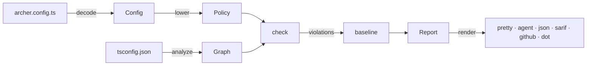
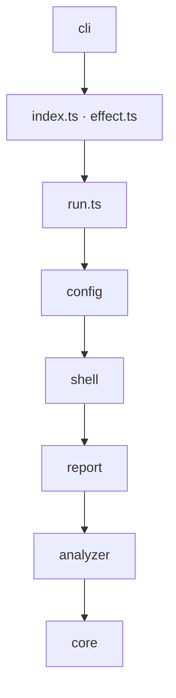

# Architecture

Archer turns a configuration and a TypeScript project into a report:

| Directory | Role |
| --- | --- |
| `src/core` | The pure part. It decodes selector text, lowers layers to rules, runs the check, and computes fingerprints and baselines. It is a port of the Lean code in `lean/`; see [verification](verification.md). |
| `src/analyzer` | The only code that talks to TypeScript. It builds a `Graph`: source files, their dependencies, declarations, exports, and calls. |
| `src/config` | The public configuration (`defineConfig`, `r`, `p`, `use`), decoded into the core's `Config`. |
| `src/report` | Reporters: pretty, agent, JSON, SARIF, GitHub, DOT. |
| `src/shell` | Loading the configuration file and the baseline file. |
| `src/run.ts`, `src/index.ts`, `src/effect.ts` | The pipeline, the Promise API, and the Effect API. |
| `src/cli` | The `archer` command. |

Each layer may depend only on the layers below it. `archer.config.ts` in the
repository root enforces this on Archer itself:

## Decisions

- **Rules are data.** A rule is a plain value. Only custom rules hold
  functions, and a custom rule that throws becomes one finding, so a check
  always finishes.
- **The check is pure.** It is `(policy, graph) → violations`. The output
  order is part of its contract: rules in policy order, then files in graph
  order. Reporters may group findings but never reorder them.
- **The Effect API is internal.** Archer is built with Effect, but the root
  export uses Promises and plain data.
- **Fingerprints ignore line numbers.** A fingerprint is the rule ID, the
  file, and the target, so moving an import does not invalidate a baseline.
- **No regular expressions.** Selectors and schema checks use structural
  matching.

## Analyzer

The analyzer uses TypeScript's async API (`typescript/unstable/async`). The
sync API needs a file descriptor for standard output, which Bun does not
provide. One TypeScript server serves all analyses in a process. Before each
analysis, the analyzer resets the server's caches, so file edits are always
seen.

What the analyzer guarantees:

- **Determinism.** The same files produce the same graph, byte for byte.
  Every ordering compares UTF-16 code units, never the locale.
- **One dependency per import site.** That includes `import`, `export … from`,
  `import type`, `import()` types, `require()`, and `import()` expressions.
- **Target classification.**
  - An import without a literal specifier is `Computed`.
  - `node:` and `bun:` imports, and bare names of Node built-ins, are
    `Builtin`.
  - A file under `node_modules` is `Package`.
  - A file in the project is `File`.
  - Anything else is `Unresolved`.
- **Graceful TypeScript gaps.** TypeScript resolves `require()` only in
  JavaScript files, and it ignores packages without types. Archer resolves
  both itself, without path aliases.
- **Failure is explicit.** An analysis returns a whole graph or an error,
  never a partial graph. If the server dies, the analysis fails with
  `AnalyzerUnavailable` and the next one starts a new server.
  `src/analyzer/server-exit.ts` works around two problems in TypeScript's
  client:
  - The client never rejects requests to a dead server, so Archer watches
    the server process through a private field of the client.
  - The bundled `vscode-jsonrpc` rethrows a failed write inside an async
    Promise executor, which leaves an unhandled rejection, so Archer does
    not report write errors on the server's stdin back to the library.

  The exact version pin and `test/analyzer/server-exit.test.ts` hold both
  workarounds in place.

`test/analyzer/contract.ts` checks these guarantees against every analyzer
adapter: `typescript`, `memory`, and `replay`.

## Performance

The check is linear or close to it in the size of the graph. One check
memoizes reachability, indexes import sites by target, and searches for
cycles only inside strongly connected components. `test/core/scale.test.ts`
fails if a 2,000-file tangle stops checking in seconds.

Watch mode runs every check in a new process. Node never frees a module it
has loaded, so a long watch session in one process would keep a copy of the
configuration for every run.
