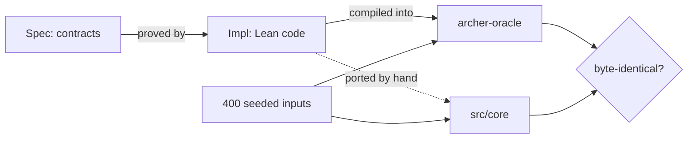

# Verification

Archer's core is specified and proved in Lean 4, in `lean/`. The TypeScript
core in `src/core` is a port of the Lean code, and tests compare the two.

```sh
npm run lean    # builds the proofs and the oracle, checks the axioms
```

## What is proved

| Area | Theorem | Guarantee |
| --- | --- | --- |
| Globs | `Pattern.accepts_iff` and related | The matcher decides the pattern semantics. A plain directory selects everything under it. |
| Reachability | `Impl.reach_spec` | Every reachable target is reported once, with a shortest import chain. |
| Check | `Impl.check_spec` | Exactly the correct violations are reported, once each, for every rule family. |
| Layers | `Impl.lower_spec` | Invalid configurations are rejected. Layer and public-API rules mean what they say. |
| Selector text | `Impl.text_spec` | Parsing follows the grammar. Printing a parsed selector parses back to it. |
| Baselines | `Impl.baseline_spec`, `Impl.encode_spec` | Fingerprints decode back exactly. A baseline splits violations correctly. |

Every theorem uses only Lean's standard axioms. `scripts/lean-audit.sh`
fails otherwise, and it also checks `lean/Challenge.lean`: hand-built cases
that the specifications must accept or reject.

## How the proofs are organized

- `lean/Archer/Spec/` states each contract as a proposition about an
  implementation, such as `CheckSpec check`.
- `lean/Archer/Impl/` defines the implementations and proves the
  propositions.

An implementation cannot weaken its contract. It can only prove the
proposition as stated, so a change to a specification shows up in a review
of `Spec/`, never in a proof. `sorry` and custom axioms are not allowed.

## How the proofs reach the TypeScript



The TypeScript port is written by hand, so it is not proved to match the
Lean code. The differential tests give strong evidence instead:

- `lean/Oracle.lean` builds `archer-oracle`. It reads a JSON array of
  requests, runs the proved Lean functions, and prints the results.
- `test/differential/core.test.ts` generates 400 seeded inputs per run,
  covering every rule family, cycles, layers, selector strings, and
  fingerprints. It sends them to both implementations and requires
  byte-identical output.

The JSON follows the Lean types mechanically. A structure becomes an
object. An enumeration becomes its constructor name as a string. Any other
constructor becomes `{"_tag": "Name", …fields}`.

## What is assumed

- **The analyzer.** The Lean model takes the graph as given. The analyzer's
  guarantees are tested ([architecture](architecture.md#analyzer)), not
  proved.
- **Custom rules.** Their functions are opaque. The model reports what they
  return.
- **Schema guards.** Decoding guarantees facts that the Lean types do not
  carry, such as non-empty import kinds and positive line limits.
